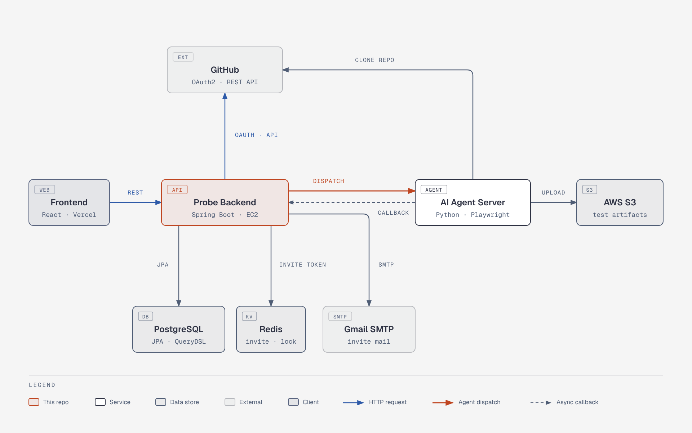
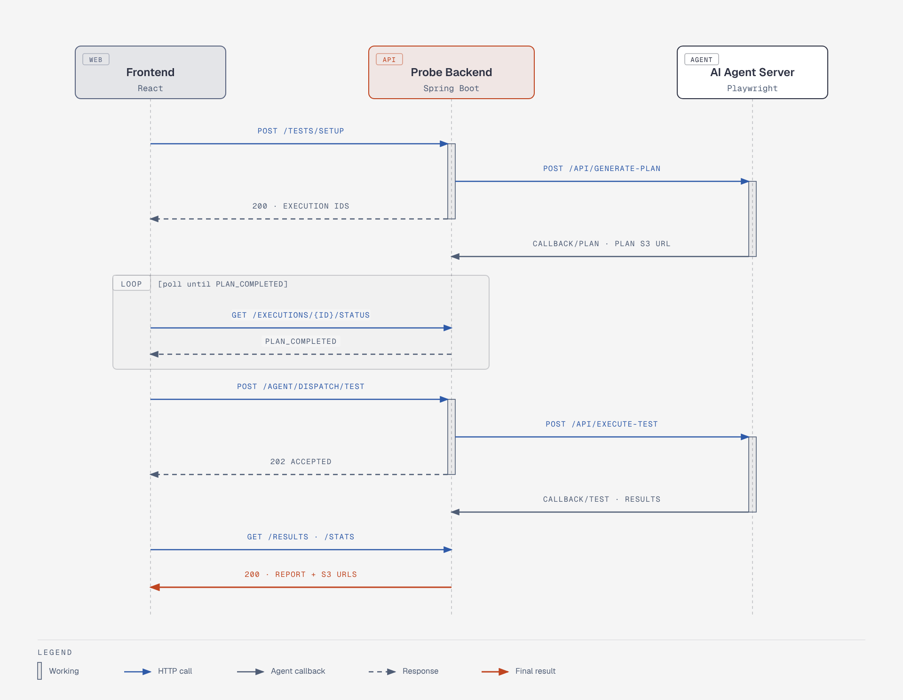

<div align="center">

# 🔎 Probe

### GitHub 저장소만 연결하면 AI가 E2E 테스트를 계획하고 실행합니다

Probe 서비스의 **백엔드 API 서버**입니다.<br>
테스트 계획서 생성과 Playwright 실행은 별도 AI Agent 서버가 맡고, 이 서버는 사용자, 프로젝트, 테스트 실행 이력과 결과를 관리하며 AI 서버와 HTTP 디스패치·콜백으로 연동합니다.

<br>


</div>

<br>

## 📖 소개

웹 서비스를 만들고 나면 회원가입, 로그인, 게시글 작성 같은 기본 흐름을 매번 손으로 확인해야 합니다. Probe는 이 반복 작업을 줄이기 위해 만든 **AI 기반 E2E 테스트 자동화 플랫폼**입니다.

- 🔗 **연결** GitHub로 로그인하고 테스트할 저장소를 고릅니다.
- 🧭 **선택** 26개 표준 시나리오(회원가입, 검색, 파일 업로드 등) 중 필요한 것을 고릅니다.
- 🤖 **생성·실행** AI Agent가 저장소 코드를 읽고 테스트 계획서를 만든 뒤 Playwright로 실행합니다.
- 📊 **확인** 케이스별 Pass/Fail, 실행 코드, 스크린샷, 계획서와 결과 보고서를 대시보드에서 봅니다.

<br>

## ✨ 주요 기능

| 영역 | 설명 |
|---|---|
| **인증** | GitHub OAuth2 로그인, JWT Access/Refresh 토큰 발급과 회전, HttpOnly 쿠키 |
| **GitHub 연동** | 내 저장소 목록 조회, 테스트 대상 저장소 저장, 저장소 코드 트리 추출 |
| **프로젝트** | 여러 저장소를 묶은 프로젝트 생성, OWNER/MEMBER 권한, 이메일 초대(24시간 토큰) |
| **테스트 시나리오** | 프로젝트 생성 시 26개 기본 시나리오 자동 등록, `T{시리얼}{회차}` 형식의 실행 ID 발급 |
| **AI Agent 연동** | 계획서 생성 → 테스트 실행 2단계 디스패치, 콜백으로 결과와 S3 산출물 URL 수신 |
| **대시보드** | 테스트 그룹·결과 목록, Pass 비율, 일별 평균 소요 시간, 케이스별 상세(시나리오·코드·스크린샷) |

<br>

## 🛠️ 기술 스택

| 구분 | 기술 |
|---|---|
| **Language / Framework** |    |
| **Security** |    |
| **Persistence** |    |
| **Cache / Store** |  |
| **External Call** | -6DB33F?style=for-the-badge&logo=spring&logoColor=white)   |
| **Infra / CI·CD** |     |
| **Docs / Test** |   |

<br>

## 🏛️ 아키텍처

### 시스템 구성

[](assets/probe-architecture.png)

- **Frontend → Backend** 모든 요청은 REST로 들어오고 JWT(Authorization 헤더 또는 `access_token` 쿠키)로 인증합니다.
- **Backend → GitHub** OAuth2 로그인 때 받은 GitHub 토큰으로 사용자의 저장소 목록과 코드를 조회합니다.
- **Backend → AI Agent** `WebClient`로 계획서 생성과 테스트 실행을 디스패치합니다. 응답을 기다리지 않는 논블로킹 호출입니다.
- **AI Agent → Backend** 작업이 끝나면 `/api/agent/callback/**`로 결과를 돌려줍니다. 산출물(계획서 xlsx, 결과 보고서, `test.spec.js`, 스크린샷)은 S3에 올리고 백엔드는 URL만 저장합니다.
- **Redis** 프로젝트 초대 토큰(TTL 24시간)과 초대 수락 시 중복 가입을 막는 분산 락에 씁니다.

### 테스트 실행 흐름

[](assets/probe-test-flow.png)

테스트 1회 실행(`TestExecution`)은 아래 상태를 거칩니다. 프론트는 상태 조회 API를 폴링하며 다음 단계로 넘어갑니다.

```
PLAN_GENERATING ──▶ PLAN_COMPLETED ──▶ TESTING ──▶ COMPLETED
       │                                  │
       └──────────────▶ FAILED ◀──────────┘
```

| 상태 | 의미 |
|---|---|
| `PLAN_GENERATING` | AI Agent에 계획서 생성을 요청한 상태 |
| `PLAN_COMPLETED` | 계획서 콜백 수신, `plan.xlsx` S3 URL 저장 |
| `TESTING` | 테스트 실행을 요청한 상태 |
| `COMPLETED` | 결과 콜백 수신, 케이스별 `TestResult`(PASS / FAIL / BLOCK / UNTEST) 저장 |
| `FAILED` | AI 서버 호출 실패 또는 실행 실패 |

> 콜백은 현재 상태가 맞을 때만 반영하므로, 같은 콜백이 두 번 와도 결과가 중복 저장되지 않습니다.

### 패키지 구조

```
com.graduationCapstone.Probe
├── domain
│   ├── user        # 사용자 조회, 회원 탈퇴
│   ├── github      # GitHub 저장소 조회·저장, 코드 추출
│   ├── project     # 프로젝트, 멤버, 초대, 기본 시나리오
│   ├── test        # 테스트 그룹·실행·결과, 통계(QueryDSL)
│   └── agent       # AI Agent 디스패치와 콜백
├── infrastructure
│   └── ai          # AI 서버 WebClient 설정, 요청 DTO
└── global
    ├── config      # Security, CORS, Async, WebClient, QueryDSL
    ├── security    # OAuth2, JWT 필터, 토큰 재발급·로그아웃
    ├── exception   # ErrorCode, 전역 예외 처리
    └── init        # 시나리오 가이드 마스터 데이터 초기화
```

<br>

## 📡 API

전체 명세는 서버 실행 후 Swagger에서 확인할 수 있습니다. `/swagger-ui/index.html`

| 도메인 | Base Path | 주요 기능 |
|---|---|---|
| 인증 | `/api/auth` | 토큰 재발급, 로그아웃 |
| 사용자 | `/api/user` | 내 정보 조회, 회원 탈퇴 |
| GitHub | `/api/github` | 저장소 목록·저장·삭제, 코드 추출 |
| 프로젝트 | `/api/projects` | 생성·수정·삭제, 멤버 초대·수락·조회, 연결 저장소 관리 |
| 테스트 | `/api/projects/{projectId}/tests` | 테스트 그룹 생성(`/setup`), 실행 상태, 결과 상세, 통계, 계획서·보고서 다운로드 |
| 에이전트 | `/api/agent` | 테스트 실행 디스패치 |
| 콜백 | `/api/agent/callback` | AI Agent 전용 계획서·테스트 완료 콜백 |

<br>

## 🚀 시작하기

### 요구 사항

- JDK 21
- PostgreSQL, Redis
- GitHub OAuth App (Client ID / Secret)
- 연동할 AI Agent 서버 주소

### 환경 변수

`src/main/resources/application.yml`이 아래 값을 읽습니다.

| 변수 | 설명 |
|---|---|
| `SPRING_DATASOURCE_URL` / `SPRING_DATASOURCE_USERNAME` / `SPRING_DATASOURCE_PASSWORD` | PostgreSQL 접속 정보 |
| `REDIS_HOST` / `REDIS_PORT` | Redis 접속 정보 |
| `GH_CLIENT_ID` / `GH_CLIENT_SECRET` | GitHub OAuth App |
| `JWT_SECRET` | JWT 서명 키 |
| `FRONTEND_REDIRECT_URL` | 로그인 성공 후 이동할 프론트 주소(콤마로 여러 개) |
| `CORS_ALLOWED_ORIGINS` | 허용할 Origin |
| `MAIL_USERNAME` / `MAIL_PASSWORD` | 초대 메일 발송용 Gmail 계정 |
| `SERVER_URL` | 이 서버의 외부 주소(초대 링크, AI 콜백 URL 생성에 사용) |
| `AI_SERVER_URL` | AI Agent 서버 주소 |

> GitHub OAuth `redirect-uri`는 `application.yml`에 운영 도메인으로 고정되어 있습니다. 로컬에서 로그인까지 확인하려면 이 값과 OAuth App 설정을 로컬 주소로 맞춰야 합니다.

### 실행

```bash
./gradlew bootRun
```

### Docker

```bash
docker build -t probe-backend .
docker run -p 8080:8080 --env-file .env probe-backend
```

<br>

## 🔄 CI/CD

`main` 브랜치에 push되면 GitHub Actions(`.github/workflows/deploy.yml`)가 배포까지 진행합니다.

1. JDK 21로 `./gradlew clean build -x test`
2. Docker 이미지 빌드 후 Docker Hub에 push
3. Actions 러너 IP를 EC2 보안 그룹에 잠시 추가
4. SSH로 EC2에 접속해 `.env` 생성 후 `docker-compose up -d --force-recreate`
5. 성공 여부와 상관없이 추가했던 러너 IP를 보안 그룹에서 제거

<br>

## ✅ 테스트

```bash
./gradlew test
```

테스트는 PostgreSQL 대신 H2 인메모리 DB를 쓰고, GitHub API와 AI 서버 호출은 MockWebServer로 대체합니다.

<br>

## 📐 컨벤션

### 브랜치 · 커밋

```
브랜치  CST-<이슈번호>/<작업 내용>        예) CST-97/Fix
커밋    [CST-<이슈번호>] <type>: <설명>   예) [CST-97] fix: 개별 테스트 코드 소요 시간 소수점까지 반환하도록 수정
```

- `main`에 직접 push하지 않고, 이슈 브랜치에서 작업한 뒤 PR로 머지합니다.
- 이슈와 PR은 `.github`의 템플릿(feature / fix / maintenance)을 사용합니다.

<br>

## 🧩 관련 저장소

| 저장소 | 역할 |
|---|---|
| [Frontend](https://github.com/GraduationCapstone/Frontend) | 웹 클라이언트 (React, TypeScript, Vite) |
| [AI](https://github.com/GraduationCapstone/AI) | 테스트 계획 생성과 Playwright 실행을 맡는 AI Agent 서버 |
| **Backend** | 이 저장소 |

<br>

<div align="center">

**GraduationCapstone · Probe**

</div>
